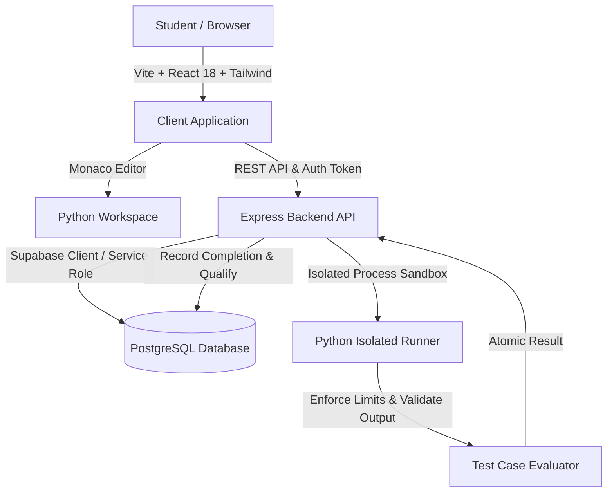

# System Design: Samagra 1000 Platform Architecture

## Architecture Overview

## Key Architectural Decisions

1. **Private Test Security**:
   - Private test cases are kept strictly server-side.
   - Frontend API responses only receive aggregated status for private tests, preventing test scraping or solution reverse-engineering.

2. **Sequential Unlocking**:
   - `student_progress.current_unlocked_sequence` dictates which questions can be opened.
   - Server-side validation guarantees that question $N$ cannot be marked complete unless verified tests pass.

3. **Atomic Scholarship Qualification**:
   - Database trigger/procedure `record_problem_completion_atomic` calculates distinct verified completions.
   - When count reaches 1,000, a unique `SAMAGRA-1000-XXXXXXXX` qualification record is inserted with idempotency constraints.

4. **Dual Engine Judge Model**:
   - Remote Judge0 support via API keys.
   - Self-contained local isolated Python process runner executing with subprocess isolation, timeout limits, and memory bounds.
